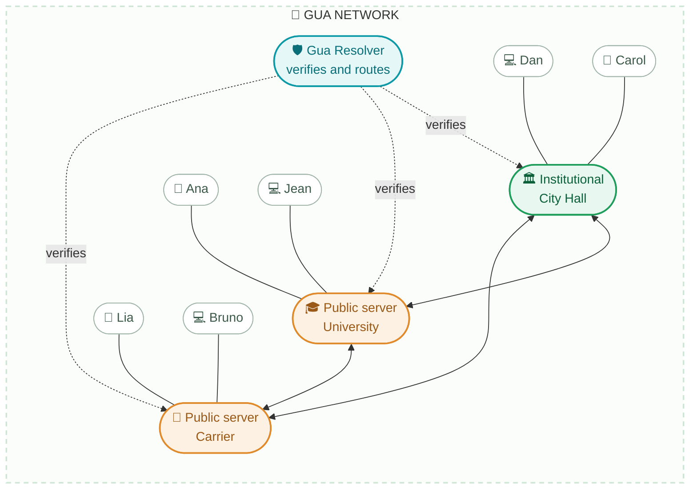

  

<h1 align="center">Gua</h1>

  <strong>Comunicação descentralizada, segura e livre</strong> 
  <em>Decentralized, secure and free communication</em>

  
  

---

    <h3><a href="https://gua.global/about">Learn more about Gua</a></h3>

 

Gua is a private messenger built on the open [Matrix protocol](https://matrix.org). It works like the messaging apps people already use: sign in with your phone number and your passkey or PIN, find the friends who are already on it, and chat with end-to-end encryption on by default. The goal is a federation of trusted servers run by different organizations. Today one operator runs the prototype.

Gua is a **prototype in an invite-only beta**. Features may change, break or be incomplete, and it is not yet meant to be critical infrastructure. Personal use is designed to stay free.

---

  

<em>Named after the <strong>lobo-guará</strong>, the maned wolf of Brazil. An animal that roams long distances and lives in no pack.</em> Photo: <a href="https://www.flickr.com/photos/26094756@N04/10542455354/">"maned wolf"</a> by Kathrin Mezger, <a href="https://creativecommons.org/licenses/by-sa/2.0/">CC BY-SA 2.0</a>

---

    <h3>Why Gua exists</h3>

Most of our conversations now live inside closed platforms, where one company controls the app, the servers, the rules, the code and your data. That creates dependency and fragility: the platform can change the rules overnight, mine your information to train AI models, block accounts, or shut a service down, and you have little real control.

Open source alone doesn't fix this. An app can have open code and still run on a **centralized network** where accounts, contact discovery, routing and operation all flow through infrastructure owned by one organization (e.g. [Signal](https://signal.org)). Better than a closed commercial platform, but still a single center of control.

Gua aims at a simple, modern-messenger experience, with open code and end-to-end encryption, on a network that does not need to belong to any single company, foundation or provider.

The vision is an open foundation for secure communication between people, communities, organizations, universities, local governments and institutions that need **digital sovereignty**, without giving up a simple experience for the everyday user. The goal is an open, federated, secure network: easy enough that people never have to think about it, and open enough that institutions can take part without handing all control to a central platform.

    <h3>How the federation works</h3>

Gua is designed so that different organizations, such as universities, carriers and public institutions, can each run a trusted server on the same network. A small service called the Gua Resolver tells the app which server to use and publishes the signed list of servers in the network, called the roster.

In a **centralized** app, everyone depends on the same company's servers. In a **federated** network, many servers share one network. Each server is run by a trusted organization, community or institution. It works the way email does: accounts on different providers can still write to each other. In Gua, those conversations are end-to-end encrypted.

Today federation is open at the Matrix layer, so a Gua server can also exchange messages with other Matrix servers. Limiting federation to the servers on the roster is a proposal and is not in place yet. The goal is a secure network where trust can be checked, not assumed.

The network's "front door" is a small service called the [**Gua Resolver**](https://github.com/Gua-ra/gua-resolver). Before you sign in, the app asks the resolver which server holds your account. The resolver also publishes the roster, and the roster decides where new Gua accounts are created. Today the operator that runs the resolver admits servers to the roster, and anyone can read it and check its signatures. The apps do not check those signatures yet. The resolver does not run the network, and it never signs you in. It helps answer three questions:

1. **Which server** holds this account?
2. **Is that server** a trusted member of the Gua network?
3. **Are the rules** for placing new accounts on servers public, so anyone can check them?

## Try it

Gua is in an invite-only beta on iOS and Android. Request access with the beta form at [gua.global/support](https://gua.global/support#beta-form). Approved testers receive an invitation by email: TestFlight on iOS, Firebase App Distribution on Android. The web client at [chat.gua.global](https://chat.gua.global) signs in accounts that already exist.

## Repositories

The public repositories are under [**github.com/Gua-ra**](https://github.com/Gua-ra).

| Repository | What it is |
| --- | --- |
| [**gua-ios**](https://github.com/Gua-ra/gua-ios) | iOS client. A fork of Element X iOS carrying the Gua product layer: resolver routing, phone sign-in with a passkey or account PIN as the second step, contact discovery. |
| [**gua-android**](https://github.com/Gua-ra/gua-android) | Android client. A fork of Element X Android with the same product layer. |
| [**gua-web**](https://github.com/Gua-ra/gua-web) | Web client. A fork of Element Web with resolver routing and phone sign-in. It has no contact discovery, and calls are off. |
| [**gua-resolver**](https://github.com/Gua-ra/gua-resolver) | The network's "front door": tells the app which server holds an account, and publishes the roster, the signed list of Gua servers that decides where new accounts are created. |
| [**identity-service**](https://github.com/Gua-ra/identity-service) | Sign-up, sign-in, the account PIN and passkeys, and contact discovery for the prototype today. |
| [**gua-auth-service**](https://github.com/Gua-ra/gua-auth-service) | The authentication service that runs next to each homeserver. A fork of Matrix Authentication Service. |
| [**gua-branding**](https://github.com/Gua-ra/gua-branding) | Logos, icons and other brand assets. |
| [**rust-opa-wasm**](https://github.com/Gua-ra/rust-opa-wasm) | Gua's fork of `matrix-org/rust-opa-wasm` with no code changes. gua-auth-service pins upstream commit `a3b8cb70` (branch `gua/wasmtime-lt-50`). |

The sign-in web screens, the deployment manifests and the support inbox live in private repositories.

**How it fits together:**

- **Clients**: `gua-ios`, `gua-android`, `gua-web`: the apps people use.
- **Federation & trust**: `gua-resolver`: points the app to the server that holds an account, and publishes the signed roster of Gua servers.
- **Identity & sign-in**: `identity-service`, `gua-auth-service`: sign-up, finding contacts and sign-in. In the target design, each server signs in its own accounts.

## Architecture

Start with [Gua identity and federation](https://github.com/Gua-ra/gua-resolver/blob/main/docs/architecture/gua-identity-and-federation.md), a plain-language guide that separates what is built today from the target. What is not built yet, and the rules it must keep, is in [planned federation work](https://github.com/Gua-ra/gua-resolver/blob/main/docs/architecture/planned-federation-work.md). The signed formats are in [signed federation objects](https://github.com/Gua-ra/gua-resolver/blob/main/docs/specs/federation-signed-objects.md).

## Licenses

The three clients and the authentication service are forks of Element projects and keep upstream's licenses: AGPL-3.0 (`gua-web` also GPL-3.0), with Element's commercial license as an alternative for the upstream code. Gua's modifications are available under AGPL-3.0. `rust-opa-wasm` is Apache-2.0, as upstream. `identity-service`, `gua-resolver` and `gua-branding` have no license yet, so they are public to read but not licensed for reuse.

## Security

Report vulnerabilities privately, as described in the [security policy](https://github.com/Gua-ra/.github/blob/main/SECURITY.md): use **Report a vulnerability** on the repository's Security tab where it exists, or email [support@gua.global](mailto:support@gua.global) with "Security" in the subject. Never a public issue.

## Contributing

Bug reports and small, focused pull requests are welcome. See [CONTRIBUTING.md](https://github.com/Gua-ra/.github/blob/main/CONTRIBUTING.md).

## Contact

- **Support and beta access:** [gua.global/support](https://gua.global/support) or [support@gua.global](mailto:support@gua.global)
- **General contact:** [contact@gua.global](mailto:contact@gua.global)

---

<em>Built on the open <a href="https://matrix.org">Matrix protocol</a>. 🐺</em>

